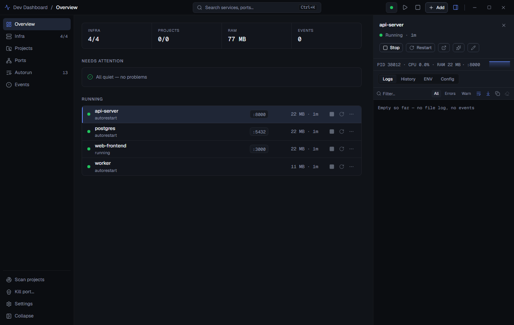

# Dev Dashboard

**One window for everything running on your dev machine.**

[](https://github.com/dvinerlove/dev-dashboard/releases)
[](LICENSE)
[](https://github.com/dvinerlove/dev-dashboard/actions/workflows/ci.yml)



Dev Dashboard is a local control panel for dev services: dev servers, databases, tunnels, containers. It shows what's up and what's down, restarts what crashes, tells you which process owns which port, and exposes all of it to AI agents over MCP. Everything runs and stays on your machine — no account, no telemetry.

## Features

- **Run services without babysitting them** — start/stop/restart from one list; stop kills the whole process tree (Windows Job Objects, `killpg` on POSIX), not just the top process
- **Crashes restart themselves, then stop** — auto-restart backs off 2→5→10→20 s, and a circuit breaker gives up after 5 crashes per minute, filing a `crash_loop` issue instead of looping forever
- **Start dependencies in order** — `depends_on` waits for a dependency's health URL (HTTP), its first port (TCP), or a process that stays up, before starting what needs it
- **Answer "what's holding this port?" at a glance** — every TCP listener on the machine, attributed to your services, flagged when it's reachable from the LAN
- **Watch what you don't run locally** — HTTP, TCP, and Docker monitors for remote services; Supabase and ZeroTier probes included
- **Edit env vars without leaking secrets** — per-service env overrides in the UI; values whose names look secret (`TOKEN`, `SECRET`, `KEY`, `PASSWORD`, `PASS`, `AUTH`, `CREDENTIAL`, `JWT`, `SESSION`) are masked in API responses
- **Know why something is red** — an issues feed collects crashes, port conflicts, dependency timeouts, and errors parsed from service logs; run and issue history persists in SQLite
- **Let AI agents operate it** — a zero-dependency stdio MCP server (7 tools) lets Cursor, Cline, or Codex list services, read logs, and restart things — [setup](README_MCP.md)
- **Lives on the desktop** — system tray, launch-at-login manager, single instance, RU/EN UI, six themes
- **Works headless too** — `python dashboard.py --web` serves the same UI and API in a browser

## Install

| Method | How |
|---|---|
| Windows app | Download `DevDashboard-windows-x64.zip` from [Releases](https://github.com/dvinerlove/dev-dashboard/releases), unzip anywhere, run `DevDashboard.exe` |
| From source | See [Build from source](#build-from-source) below — works anywhere Python runs |
| winget / scoop | Not yet installable — manifests are prepared in [`packaging/`](packaging/) and submission PRs are pending |

Each release also ships a `.sha256` file for the zip — check it before running if you want to verify the download.

### About the SmartScreen warning

The exe is **not code-signed**, so Windows SmartScreen will show a "Windows protected your PC" warning on first run. This is expected for an unsigned open-source build — reputation takes time and real certificates cost money. Click **More info → Run anyway**, verify the SHA256, or [build from source](#build-from-source) if you prefer not to trust a binary.

### Build from source

Requirements: Python 3.10+, Node 20+, Microsoft Edge WebView2 Runtime (preinstalled on Windows 10/11; needed for the windowed mode only).

```bash
pip install -r requirements.txt
cd frontend && npm ci && npm run build && cd ..
python dashboard.py
```

Headless / remote:

```bash
python dashboard.py --web   # UI + API at http://127.0.0.1:4850
```

## Quick start

1. **First launch** opens the onboarding dialog: point it at your project folders and it suggests projects found by the project scanner.
2. **Or add a service manually** — a name plus one way to detect it is enough: a port, a process name (`proc`), or a command-line substring (`match`). Add a `start` command if you want the dashboard to run it for you; leave it out for `monitor_only` watching.
3. **Wire dependencies** — set `depends_on` and a `health_url` so a service starts only after its dependencies are ready.
4. **Turn on `autorestart`** for anything that should stay up.

Config files are plain JSON in the [data directory](#data-location) — edit by hand or through the UI. First run starts empty: there are no bundled services, what you see is yours.

## Configuration

### `services_config.json` — array of service specs

| Field | Type | Meaning |
|---|---|---|
| `name` | string | **Required.** Display name, also the primary key |
| `sub` | string | Secondary label shown under the name |
| `ports` | int[] | Ports the service listens on; `ports[0]` drives the chip and the TCP readiness check |
| `proc` | string | Process name to match when probing (e.g. `postgres.exe`) |
| `match` | string | Substring match against the process command line |
| `url` | string | "Open" link for the service |
| `start` | string | Command used to start the service |
| `cwd` | string | Working directory for `start` |
| `env` | object | Env var overrides for the started process |
| `env_key` / `env_file` | string | Read a secret from an `.env` file (`env_file`, defaults to `<data dir>/.env`) — used for monitor auth headers and editable via the env editor |
| `autorestart` | bool | Restart on unexpected exit, with backoff + circuit breaker |
| `monitor_only` | bool | Probe the process but never start/stop it |
| `depends_on` | string[] | Service names that must be healthy first (see below) |
| `health_url` | string | HTTP readiness URL for `depends_on` (2xx–3xx = ready); without it falls back to first port, then "alive 0.5s" |
| `type` | `http` \| `tcp` \| `docker` | Remote monitor — no local process; probe a URL, `host`+`port`, or `container` name via `docker ps` |
| `host`, `port` | string, int | For `type: "tcp"` monitors |
| `container` | string | Container name for `type: "docker"` |
| `keyword` | string | For `type: "http"`: body must contain this, else "dead" |
| `interval` | int | Remote probe period in seconds (default: docker 15, supabase 60, other 30) |
| `zerotier` | bool | Vendor probe: ZeroTier via its local API |
| `zt_token` | string | ZeroTier authtoken override (default: read from the service's authtoken file) |
| `supabase` | bool | HTTP probe variant: sends `apikey` + `Authorization: Bearer` from `env_key`/`env_file` |
| `path` | string | Project path — enables the "open folder" affordance |
| `note` | string | Custom "off" reason (docker: shown when no container is found) |

### `projects_config.json` — array of project specs

| Field | Type | Meaning |
|---|---|---|
| `name` | string | **Required.** Display name |
| `cmd` | string | Command run via the shell (e.g. `npm run dev`) |
| `cwd` | string | Working directory |
| `url` | string | Optional "open" link |
| `sub`, `ports`, `env`, `autorestart` | — | Same semantics as services |

### `settings.json`

| Key | Default | Meaning |
|---|---|---|
| `api_port` | `4850` | Local HTTP API port; if busy, the next free port (up to +9) is used |
| `probe_interval` | `4` | Local probe loop period, seconds |
| `dep_timeout` | `15` | How long `depends_on` waits before cancelling a start (`deps_timeout` issue) |
| `backoff` | `[2, 5, 10, 20]` | Auto-restart delays, seconds (reset after 60s uptime) |
| `scan_roots` | `[]` | Folders scanned for projects; `[]` = auto-detect |
| `port_mine` | `[]` | Process names marked as "mine" in the ports view |
| `port_hidden` | `[]` | Process names hidden from the ports view |
| `lang` | `"auto"` | `auto` = OS language (non-Russian falls back to English) |

Deleting a service in the UI removes it from `services_config.json`.

### Data location

| Case | Path |
|---|---|
| Windows | `%LOCALAPPDATA%\DevDashboard` |
| Linux | `~/.config/dev-dashboard` (or `$XDG_CONFIG_HOME/dev-dashboard`) |
| macOS | `~/Library/Application Support/DevDashboard` |
| Portable | If any of `services_config.json`, `projects_config.json`, `settings.json`, `state.db` already exists next to the exe/script, that folder is used |
| Override | `DEVDASH_DATA_DIR` env var always wins |

Secrets are never written to `state.db`.

## Web mode

`python dashboard.py --web` runs without the desktop window — the same UI and API are served at `http://127.0.0.1:4850`. This is the supported way to run on macOS and Linux (the pywebview window is untested on POSIX), and it works for a headless box you reach through a browser. The API binds to `127.0.0.1` only; POST endpoints are behind a CSRF Origin check and a Host allowlist.

## MCP server

`mcp_server.py` is a zero-dependency stdio MCP server that proxies the local HTTP API — lets AI agents see service state, logs, issues, and start/stop services. Setup: [README_MCP.md](README_MCP.md).

## Platform support

| Platform | Status |
|---|---|
| Windows 10/11 | ✅ Supported — native window, tray, Job Objects, autorun, exe build |
| macOS | ⚠️ Untested — the POSIX code path exists and CI builds pass, but it has never been run on a real machine. `--web` mode should work; please report issues |
| Linux | ⚠️ Untested — same POSIX path, same caveat: `--web` mode should work; please report issues |

## Privacy

No telemetry, no analytics, no network calls except the probes you configure. The API binds to `127.0.0.1` only — do not expose it; it can start and stop processes (see [SECURITY.md](SECURITY.md)).

## Development

```bash
cd frontend && npm ci && npm run build   # tsc -b + vite build → dist/
python test_upgrades.py                  # core tests (Job objects, backoff, deps, parser, env)
python _t/i18n_check.py                  # i18n coverage check
cd frontend && npx tsc --noEmit          # frontend typecheck
pyinstaller DevDashboard.spec            # build the exe
```

Backend logic lives in `backend.py` (Qt/web-free), the API + probe loop in `core.py`, platform branches in `platform_impl.py`. See `AGENTS.md` for the architecture notes and [CONTRIBUTING.md](CONTRIBUTING.md) for the house rules.

## License

[MIT](LICENSE)
